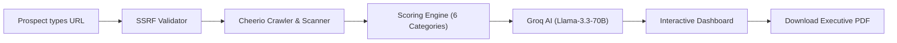

<h1 align="center">🔎 NexusAudit AI</h1>
<p align="center"><strong>Enterprise AI-Powered Website Auditor & Technical Intelligence Engine</strong></p>
<p align="center">Autonomous technical diagnostics across Performance, SEO, Security, Accessibility, Mobile Compatibility, and Code Quality powered by Groq Cloud Llama-3.3.</p>

<p align="center">
	
	
	
	
	
	
	
</p>

---

## 📖 About NexusAudit AI

**NexusAudit AI** turns any live public URL into an executive-grade technical audit report in under 15 seconds. It fetches the target page, inspects HTML metadata, evaluates SSL/security headers and linked resources, computes objective multi-category health scores, and uses **Groq AI (`llama-3.3-70b-versatile`)** to synthesize consultant-level findings, remediation priorities, and code fixes.

Clients and prospect leads can download an instant, beautifully formatted **Executive PDF Report** directly from the audit dashboard.

---

## ✨ Features

- **Autonomous Multi-Category Scanning:** Performance, SEO, Security headers, Accessibility, Mobile readiness, and Code quality.
- **Sub-Second Groq AI Analysis:** Powered by Llama-3.3-70B via Groq Cloud for instant strategic recommendations.
- **SSRF-Safe Scanning:** Hardened parser blocks loopback, private networks, and internal cloud metadata IPs (AWS/GCP).
- **Executive PDF Export:** Single-click client-ready PDF reports generated server-side with PDFKit.
- **Interactive Code Fixes:** Real-time AI recommendations with copy-paste code snippets for detected vulnerabilities.
- **Audit History & Benchmarks:** Built-in persistence (`node:sqlite`) tracking site health score evolution over time.
- **Modern Responsive Dark Theme:** Built with React 19, Tailwind CSS, Framer Motion, and Recharts.

---

## 🛠️ Tech Stack

- **Frontend:** React 19, Vite, Tailwind CSS, Framer Motion, Recharts
- **Backend API:** Express.js, Cheerio, PDFKit, node:sqlite
- **AI Engine:** Groq Cloud (`llama-3.3-70b-versatile`)
- **Deployment:** Render Free Web Service, Docker, or Node.js 22+

---

## ⚙️ How It Works



1. **Submission:** User enters a website URL in the hero input.
2. **SSRF Guard:** The server validates the URL and ensures internal IP ranges (127.0.0.1, 10.x, 192.168.x, 169.254.x) are blocked.
3. **Deep Scan:** Live HTML, response headers, sitemap, and robots.txt are parsed.
4. **Scoring:** Algorithmic calculation of Category Scores (0–100).
5. **AI Synthesis:** Groq's high-throughput LLM evaluates key findings, assigns severity (High, Medium, Low), and writes executive summaries.
6. **Delivery:** The client receives a visual dashboard and an exportable PDF report.

---

## 🚀 Quick Start

### 1. Prerequisites
- **Node.js 22.5+**
- **Groq API Key** (Free tier available at [groq.com](https://console.groq.com))

### 2. Setup Environment
```bash
git clone https://github.com/wtfear/NexusAudit.git
cd NexusAudit
cp server/.env.example server/.env
```

Add your Groq API key in `server/.env`:
```env
GROQ_API_KEY=gsk_your_groq_key
GROQ_MODEL=llama-3.3-70b-versatile
PORT=8787
CLIENT_ORIGIN=*
```

### 3. Install & Run
```bash
# Install dependencies for both frontend and backend
npm run install:all

# Run both backend and frontend concurrently
npm run dev
```
Open [http://localhost:5173](http://localhost:5173) in your browser.

---

## ☁️ Production Deployment

### Option A: Render Free Web Service ($0/month)
1. Fork or push `wtfear/NexusAudit` to GitHub.
2. In [Render Dashboard](https://dashboard.render.com), create a new **Web Service**.
3. Settings:
   - **Environment:** `Node`
   - **Plan:** `Free` (0.5 CPU / 512 MB RAM)
   - **Build Command:** `npm run install:all && npm run build`
   - **Start Command:** `npm run start`
4. Add Environment Variable:
   - `GROQ_API_KEY`: `your-groq-api-key`
   - `GROQ_MODEL`: `llama-3.3-70b-versatile`
   - `PORT`: `8787`

### Option B: Single Full-Stack Node Server
```bash
npm run build
node server/src/index.js
```
The server will automatically serve the built client bundle and API from a single port!

---

## 📄 License
Licensed under the [MIT License](LICENSE). Developed by [WTFear](https://github.com/wtfear).
